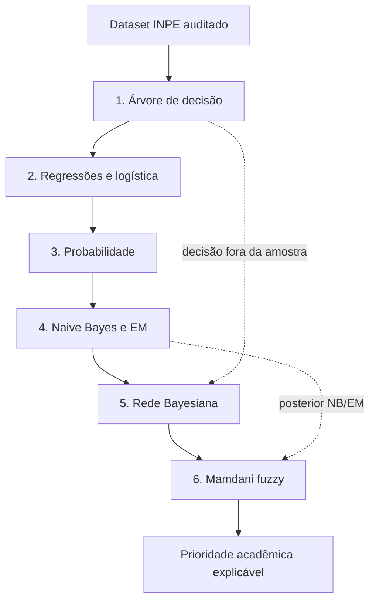

# Plano de execução e entrega

## Estado e objetivo

**Análise e planejamento concluídos em 31/10/2026. Execução acadêmica ainda não iniciada.** O próximo trabalho será montar o dataset completo; não se deve começar pela árvore antes dessa validação.

Objetivo aprovado: estimar FRP e identificar focos no quartil superior de potência, entre detecções AQUA_M-T no bioma Amazônia brasileiro. Fonte principal INPE; desenvolvimento em 2024; teste em 2025. Os requisitos completos estão na [matriz](requisitos.md), e as decisões humanas em [decisoes.md](decisoes.md).

Executar **um pacote abaixo por vez**, verificando seus critérios antes do próximo. A validação dos resultados será computacional e baseada em evidências. As decisões críticas de escopo foram discutidas com o responsável nesta fase; a revisão humana do produto completo ficará para a entrega final.



As setas verticais indicam a sequência de estudo. No fluxo computacional, a rede usa a decisão da árvore como evidência; o fuzzy recebe o posterior da rede e o do NB/EM. As regressões oferecem uma estimativa contínua complementar de FRP e a etapa 3 fundamenta os cálculos probabilísticos.

## Estrutura prevista para a entrega completa

```text
README.md
requirements.txt                 # versões confirmadas durante a execução
etapa1.ipynb ... etapa6.ipynb      # seis notebooks, na raiz
utils.py                         # dados, splits e transformações comuns
arvore.py                        # árvore do zero
linear.py                        # regressões do zero
em.py                            # NB e mistura com variável oculta
bayes.py                         # CPT e enumeração
fuzzy.py                         # Mamdani com scikit-fuzzy
scripts/
  analisar_fontes.py              # já existe: auditoria do piloto
  preparar_dados.py               # futuro: aquisição e derivação completa
data/
  manifesto.json                 # já existe: arquivos auditados nesta fase
  dicionario.csv                  # futuro: contrato final das colunas
  raw/                           # ignorado pelo Git
  processed/                     # ignorado pelo Git
docs/
  analise-dados.md
  perfil-dados.json
  fontes.md
  requisitos.md
  decisoes.md
  plano.md
  uso-de-ia.md
resultados/                      # métricas/tabelas/figuras leves reproduzíveis
tests/                           # verificações matemáticas e de integração
relatorio/
  main.tex                       # artigo 6–8 páginas, inclusive apêndice
  referencias.bib
  imagens/
  relatorio.pdf
apresentacao/                     # material para 10 minutos
```

Esta árvore é um plano: não criar notebooks vazios ou módulos fictícios para aparentar atendimento dos requisitos. Os modelos podem compartilhar dados e utilitários, preservando a implementação do zero onde o PDF exige. Não é necessário criar aplicação web, API, serviço ou infraestrutura de produção.

## Pacote 0: dataset e ambiente

**Entrada:** manifesto piloto, regras da análise e decisões aprovadas.

1. Criar ambiente reproduzível com NumPy, pandas, matplotlib, Jupyter, scikit-learn, pgmpy e scikit-fuzzy. Instalar, verificar compatibilidade e só então fixar versões. Manter `np.random.seed(42)` e controlar os geradores adicionais.
2. Baixar os 24 CSVs mensais oficiais, atualizar manifesto sem alterar silenciosamente os hashes anteriores e registrar tempo/volume.
3. Filtrar Brasil/Amazônia/AQUA_M-T; validar datas, geografia, identificadores, domínios e duplicatas; produzir fluxograma de linhas mantidas/excluídas.
4. Manter 2024 e 2025 separados antes de aprender transformações. Preservar os originais e produzir tabela derivada com procedência por linha.
5. Avaliar INMET conforme a análise; registrar cobertura e distância. Essa avaliação não condiciona a existência de uma versão principal baseada só no INPE.
6. Criar cinco folds agrupados por município em 2024, sem misturar um município entre treino e validação do mesmo fold. Confirmar as duas classes em cada fold. Usar município válido ou chave espacial substituta documentada quando faltar identificador, sem simplesmente atribuir cada linha a um grupo diferente.
7. Criar também validação temporal progressiva em 2024, com cinco janelas consecutivas e treino sempre anterior à validação, para detectar otimismo da divisão espacial. Reduzir o treino de algoritmos do zero por amostragem determinística de grupos, se o custo for excessivo; justificar e manter as mesmas amostras nas comparações. Não reduzir o teste conforme o alvo.

**Saída:** dataset auditado, dicionário, manifesto completo, definição dos folds, ambiente e política de alvos.

**Aceite:** nenhum identificador compartilhado entre treino e teste; todos os filtros rastreáveis; anos/sensores corretos; teste sem ajuste de transformações; cada fold com suporte de classes; nenhuma perda silenciosa de registros. O conjunto final ainda não tem tamanho confirmado.

**Commit previsto:** `Constrói o dataset auditado de focos da Amazônia`.

## Pacote 1: árvore de decisão

Usar os seis atributos aprovados ou a substituição justificada no pacote 0. Para a árvore didática, discretizar numericamente no treino em partições pequenas e interpretáveis, compatíveis com o pseudocódigo ID3. Tratar classes uniformes, ausência de atributos, subárvore sem exemplos, empate de ganho e categorias não vistas. Limitar complexidade por validação de 2024.

Produzir a implementação do zero, comparação scikit-learn, cinco folds e exemplo de revisão de uma conclusão com novos exemplos. Construir uma tabela manual para raiz, filhos e netos, com frequências e ganho dos candidatos; reservar espaço para isso no artigo, não somente em anexo externo.

**Aceite:** entropia zero em classe pura e 1 bit em duas classes equiprováveis; ganho calculado confere com as contagens; mesmo protocolo nos dois modelos; acurácia média de validação e comparação com a maioria; meia página sobre monotonicidade.

**Commits previstos:** `Implementa a árvore de decisão por ganho de informação`; `Compara a árvore e documenta os três primeiros níveis`.

## Pacote 2: regressões

Começar pela fórmula fechada univariada entre dias sem chuva e FRP; depois implementar regressão multivariada com gradiente, Ridge L2 e logística. Padronizar usando só o treino. Registrar função objetivo, normalização da perda, tamanho do passo, intercepto, parada e curva de convergência. Escolher lambda e demais opções dentro de 2024.

Comparar com as bibliotecas usando objetivos compatíveis; não exigir coeficientes idênticos se penalizações ou normalizações forem diferentes. Reportar R², MAE e RMSE para regressão, inclusive nos extremos; comparar com média/mediana de treino. Para a classificação, usar a política comum descrita adiante. Não prometer R² positivo.

**Aceite:** gradiente conferido numericamente; solução de mínimos quadrados coerente em exemplo controlado; perda finita; gráfico coeficientes vs. lambda; comparação linear/logística executada.

**Commits previstos:** `Implementa regressões lineares e Ridge do zero`; `Implementa a classificação logística e compara modelos`.

## Pacote 3: probabilidade

Definir estiagem prolongada e chuva baixa no treino, usando regras explícitas que não produzam categorias vazias. Calcular conjunta de duas binárias, marginais, condicionais, cadeia para três variáveis e Bayes para FRP elevada. Mostrar frequências e denominadores, além dos resultados numéricos. Não reportar uma condicional com denominador zero como se fosse zero observado.

Confrontar chuva e dias sem chuva condicionados à classe, registrando evidência a favor ou contra a independência e seu limite amostral. Explicar diagnóstico, causalidade e por que uma afirmação em LPO não representa uma probabilidade numérica.

**Aceite:** quatro eventos atômicos completos; soma conjunta 1; Bayes e regra da cadeia conferem diretamente com as contagens.

**Commit previsto:** `Calcula as probabilidades do domínio e aplica Bayes`.

## Pacote 4: Naive Bayes e EM

Calcular MLE e MAP de Bernoulli com prior Beta(2,2). Implementar NB gaussiano do zero como baseline e uma extensão com **Z de dois componentes dentro de cada classe**. Nesta extensão, cada componente terá distribuição gaussiana diagonal; EM estima pesos, médias e variâncias no treino, mantendo a classe observada. O posterior da classe combina as verossimilhanças das misturas e a probabilidade da classe. Isso conecta o EM à classificação de forma explícita.

Usar log-probabilidades, normalização numericamente estável, piso de variância, tratamento de componentes com peso quase zero e inicializações reprodutíveis. Interpretar Z como componente estatístico, sem lhe atribuir um regime ecológico não demonstrado. Discutir a aproximação gaussiana para atributos temporais/cíclicos e o custo adicional da mistura.

**Aceite:** fórmulas MLE/MAP verificadas; probabilidades normalizadas; log-verossimilhança não decrescente dentro da tolerância declarada, com parada registrada; NB puro e NB+EM comparados nos mesmos folds. EM pode não melhorar a classificação; esse também será um resultado válido.

**Commits previstos:** `Implementa MLE MAP e Naive Bayes`; `Integra a variável oculta ao classificador com EM`.

## Pacote 5: rede Bayesiana

Começar com seis nós discretos: período do ano, região espacial, estiagem, chuva baixa, decisão da árvore e FRP elevada. Avaliar esta **estrutura candidata**, sem alegar causalidade comprovada: período → estiagem; região → estiagem; período → chuva baixa; período/região/estiagem/chuva baixa → decisão da árvore; estiagem/chuva baixa/decisão da árvore → FRP elevada. As arestas da decisão aprendida representam dependências de uma previsão computada, não causas físicas do fogo.

Ela inclui o colisor estiagem → FRP elevada ← chuva baixa. Exemplos de independências implicadas: estiagem e chuva baixa dados período/região; região e chuva baixa dado período, enquanto não se observa a decisão da árvore nem FRP elevada. A decisão também é um colisor; observá-la pode abrir caminhos adicionais. Essas hipóteses precisam ser confrontadas com os dados de desenvolvimento; revise a estrutura se forem inadequadas, mantendo 4–6 nós, o reuso da árvore e os exemplos exigidos. Não manipular a estrutura para demonstrar independências contraditas pelos dados.

Para estimar CPTs com a decisão da árvore como variável, gerar previsões fora da amostra dentro do conjunto de treino: em cada fold externo, fixar tau a partir desse treino; gerar decisões em subfolds internos sem que a árvore veja as próprias linhas previstas; ajustar a rede apenas nessas previsões e variáveis desse treino. Na validação externa, usar a árvore ajustada no treino externo. No ajuste final, repetir a geração fora da amostra em 2024 e congelar todo o pipeline para 2025. Não usar decisões obtidas sobre o próprio treino da árvore como evidência de qualidade generalizável.

Estimar CPTs com suavização explícita; implementar enumeração; conferir com `pgmpy.VariableElimination`. Computar o número real de parâmetros livres: `soma_i (r_i−1) produto_pais r_pai`, comparado com `produto_i r_i−1` na conjunta.

**Aceite:** DAG acíclico; CPTs normalizadas; todas as consultas conferem entre implementações; duas d-separações, colisor e economia demonstrados; decisão da árvore efetivamente reutilizada como evidência. Registrar a geração fora da amostra e comparar os resultados da rede com os de árvore e NB/EM nos mesmos casos.

**Commit previsto:** `Modela as dependências e implementa a inferência Bayesiana`.

## Pacote 6: fuzzy e integração

Usar a probabilidade posterior de FRP elevada da etapa 5 e o posterior do classificador NB/EM da etapa 4 como duas entradas; produzir prioridade de inspeção acadêmica entre 0 e 100. Assim há três variáveis linguísticas ao contar a saída, e os resultados anteriores são reutilizados de forma executável. Definir pertinências triangulares e 3–5 regras Mamdani com `scikit-fuzzy`, incluindo concordância alta/baixa e divergências entre os modelos. Garantir sobreposição e cobertura, inclusive nas fronteiras e combinações extremas.

Comparar o score suave com a decisão rígida `P(FRP elevada) >= 0,5`. Se converter prioridade em classe, explicitar o limite utilizado, sem afirmar que foi validado para operação de brigadas. Mostrar exemplos de fronteira e as regras ativadas. Os dois modelos usam dados relacionados; a combinação fuzzy não pressupõe evidências independentes, nem transforma o score final em probabilidade calibrada. Probabilidade e grau de pertinência fuzzy têm significados distintos e devem ser explicados.

**Aceite:** rede Bayesiana e NB/EM alimentam o sistema em execução; toda combinação válida de entradas tem saída finita; score/regra/casos de fronteira disponíveis; diagrama mostra árvore → rede e rede/NB → fuzzy. Sem alegar validação por especialista ainda não realizada.

**Commit previsto:** `Integra as probabilidades ao sistema fuzzy interpretável`.

## Política única de avaliação

- **Limiares de FRP:** Q75 de cada treino interno; usar o mesmo tau por fold para árvore, logística, NB e NB+EM. Registrar tau e prevalência por fold. Após selecionar o modelo, Q75 de todo 2024 fica congelado para 2025. Empates não são removidos para fabricar uma prevalência de 25%.
- **Classificação:** acurácia exigida pelo PDF; adicionar balanced accuracy, precisão, recall, F1 da classe elevada e matriz de confusão. Para modelos probabilísticos, incluir PR-AUC, Brier e calibração. Comparar todos com a classe majoritária; a acurácia sozinha pode esconder ausência de utilidade.
- **Regressão:** R², MAE e RMSE, com referências de média/mediana aprendidas no treino. A análise transformada não substitui a regressão exigida.
- **Dependência espacial/temporal:** folds por município e diagnóstico temporal em 2024; 2025 separado mede mudança de ano. Registros podem pertencer ao mesmo evento físico sem identificação disponível, limitação que deverá constar no artigo.
- **Ausências e transformações:** parâmetros aprendidos somente no treino. Identificadores, FRP, classe elevada e qualquer variável derivada deles ficam fora de X.
- **Teste de 2025:** executar somente após congelar dataset, atributos, regras, hiperparâmetros e critérios; reportar o resultado mesmo se desfavorável. A auditoria prévia de cobertura deve ser declarada.
- **Sem metas fabricadas:** as faixas de desempenho do PDF são ilustrativas; resultados e falhas serão apresentados como observados.

## Pacote 7: artigo, reprodução e apresentação

Organizar artigo em 6–8 páginas: problema/dados/protocolo; árvore e cálculos; regressões; probabilidade/EM; rede; fuzzy/integração; resultados/limitações/referências/apêndice. A distribuição exata será ajustada à renderização para comportar os cálculos manuais e meia página de monotonicidade. Arquivos complementares no repositório não substituem conteúdo explicitamente exigido no relatório.

Preparar apresentação de dez minutos: problema/dados (1 min), árvore/linear (2), probabilidade/NB/EM (2), rede/fuzzy (3), resultados/limitações (2). Documentar prompts usados e verificar o entendimento das implementações. O material atual não é o relatório final nem uma apresentação pronta.

**Aceite:** execução limpa dos seis notebooks na ordem; testes matemáticos e de integração pertinentes aprovados; métricas rastreáveis; PDF compilado e inspecionado visualmente, com 6–8 páginas; instruções verificadas em ambiente limpo; fontes e prompts registrados; apresentação cronometrada e revisão humana final.

**Commits previstos:** `Consolida os resultados e a reprodução do pipeline`; `Redige o relatório e prepara a apresentação final`.

## Cronograma relativo do PDF

| Semana | Pacotes | Marco verificável |
|---|---|---|
| 1 | 0 e 1; início do 2 | Dataset auditado; árvore completa; modelos lineares iniciados |
| 2 | Concluir 2; executar 3 e 4 | Linear, probabilidade e EM completos; checkpoint no GitHub na sexta da semana correspondente |
| 3 | 5, 6 e 7 | Integração, artigo, apresentação e entrega revisada |

Não foram inventadas datas absolutas ou duração exata de programação. INMET só entra se a associação for tecnicamente sustentada e não impedir a entrega obrigatória. Resultados insuficientes de modelagem exigem discussão, não troca oportunista do teste.

Cada commit será atômico, em português, com autoria e `Signed-off-by` aprovados. Se um pacote exigir mudanças independentes, dividir em commits menores. Nunca acumular toda a implementação para um único commit final.
